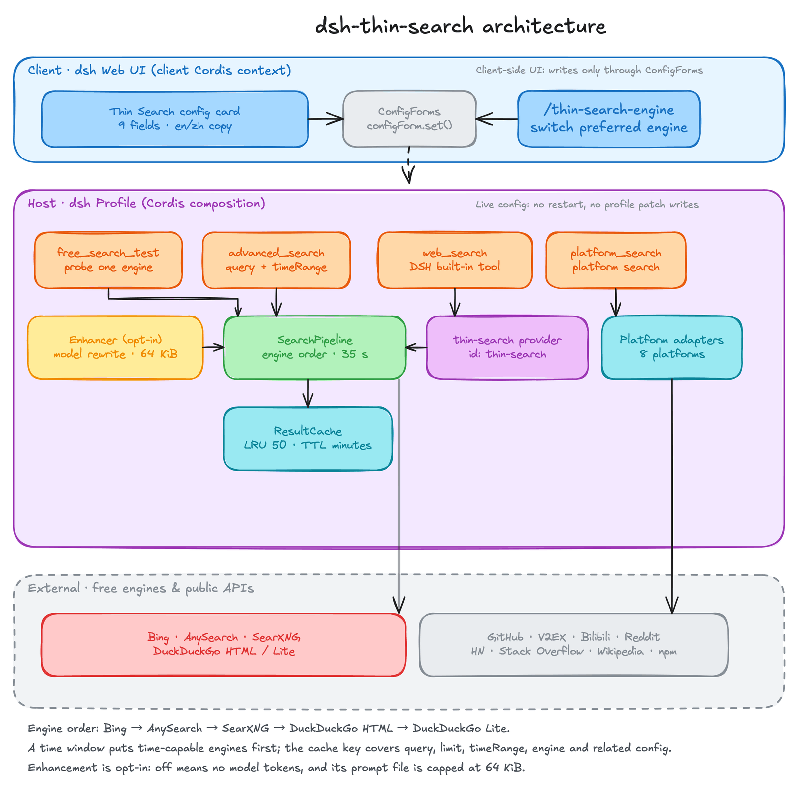

<h1 align="center">dsh-thin-search</h1>

<p align="center">
  <a href="README.md">简体中文</a> · <strong>English</strong>
</p>

<p align="center">
  <a href="https://github.com/topics/dsh-plugin"></a>
  <a href="https://opensource.org/licenses/MIT"></a>
  <a href="https://www.npmjs.com/package/@deepseek-ai/dsh"></a>
  <a href="https://nodejs.org">=24.9" src="https://img.shields.io/badge/node-%3E%3D24.9-339933?style=flat" /></a>
</p>

<p align="center">
  <strong>Free, keyless web search: plain HTTP requests to free engines instead of a model-backed search call.</strong><br>
  A native <code>WebSearchProvider</code> (<code>id: thin-search</code>) with five-engine fallback, time ranges and a
  result cache — it spends no model tokens unless query enhancement is explicitly enabled.
</p>

v1.0.0 is a complete rewrite for **DSH 0.2.2-rc.3** and supports **only that release**: it carries no
compatibility branches for DSH 0.1.x, 0.2.0 or 0.2.1.

## ✨ Features

- **Five free engines with automatic fallback**: Bing (default), AnySearch, SearXNG,
  DuckDuckGo HTML and DuckDuckGo Lite.
- **Native search provider**: registers a `WebSearchProvider` (`id: thin-search`) that coexists
  with other registered providers and is selected through the global web search setting.
- **Time ranges**: `advanced_search` accepts fixed tiers, relative durations and absolute dates.
- **Result cache**: an in-memory LRU with a minutes-based TTL; the cache is consulted before
  enhancement, so a hit never calls a model.
- **Optional query enhancement**: rewrites the query through the current Agent model, with an
  exclusive `provider:model` override and a prompt file.
- **Eight platform adapters**: GitHub, V2EX, Bilibili, Reddit, Hacker News, Stack Overflow,
  Wikipedia and npm.
- **Three Agent tools**: each forwards cancellation and renders text content blocks.
- **Native configuration card**: on the installed bundle's page
  (Plugins → Installed → dsh-thin-search → Configuration), with en/zh copy, plus the
  `/thin-search-engine` command.
- **No deployment writes**: no HTTP bridge, no private configuration store and no profile patch
  writes; provider switches use ConfigForms and apply live.

## 📦 Requirements

| Item | Requirement |
|---|---|
| DSH | `0.2.2-rc.3` (exact; declared in `engines.dsh` and the peer dependencies) |
| Node | Node 24.9 or newer (`engines.node`: `>=24.9.0`) |
| Cordis | `~4.1.0` |
| Runtime dependencies | `@deepseek-ai/schemastery`, `node-html-parser` |

## 🚀 Install

```sh
dsh plugin --profile web add dsh-thin-search
```

Restart `dsh web` once. The bundle patch inserts the `thin-search` row and sets the first-boot
default:

```yaml
- insert:
    - id: thin-search
      name: dsh-thin-search
      config:
        provider: bing
        bingMarket: zh-CN
- id: web
  config:
    searchProvider: thin-search
    fetchProvider: http
```

The patch only sets `web.searchProvider` and `web.fetchProvider`; it never rewrites a profile and
never edits other rows. Uninstall with:

```sh
dsh plugin --profile web remove dsh-thin-search
```

Restart afterwards to return to whichever provider the deployment selects next.

## 🔄 Migration

### Compatibility

| DSH version | Status | Notes |
|---|---|---|
| `0.2.2-rc.3` | ✅ Supported | The only target of v1.0.0, declared in `engines.dsh` and the peer dependencies |
| Older releases | ❌ Unsupported | v1.0.0 is not supported on older DSH releases; stay on v0.6.x |

### From v0.6.x or older

v0.6.x targeted DSH 0.1.7–0.2.1 and shipped a plugin-level HTTP proxy, a settings bridge and a UI
engine test control. Those surfaces are removed in v1.0.0.

1. Move to DSH 0.2.2-rc.3 and Node 24.9+. v1.0.0 is not supported on older DSH releases;
   compatibility is declared in `engines.dsh` and the peer dependencies, but the plugin does not
   enforce a runtime version gate.
2. Replace the old `proxy` field with the DSH global proxy policy: set `HTTP_PROXY`, `HTTPS_PROXY`
   and (when needed) `NO_PROXY` before starting DSH. Thin Search uses the shared HTTP client, so
   there is no per-plugin proxy setting anymore.
3. Delete the old `cache` boolean; `cacheTtl` now also acts as the on/off switch (`0` disables) and
   defaults to `5` minutes.
4. Replace `enhanceSystemPrompt` with `enhanceSystemPromptPath`. Prompt text no longer lives in
   `cordis.patch.yml`; write it to a file such as `~/.dsh/thin-search/system-prompt.md` and point
   the field at it.
5. Delete any manually maintained `web` engine-mode block from a profile patch. The bundled patch
   pins the provider once; later switches go through ConfigForms and take effect immediately.
6. Keep existing Agent instructions: the provider id `thin-search` and the tool names
   `free_search_test`, `platform_search` and `advanced_search` are unchanged.
7. Delete `tools.mode` and `tools.maxParallelSubCalls` from the `tools` row in the profile patch.
   DSH 0.2.2-rc.3 declares both fields as `z.never()` and rejects every value. The composition
   mounts the executor instead, for example the native or PTC tool-executor bundle
   (`@deepseek-ai/dsh-tool-executor-native` or `@deepseek-ai/dsh-tool-executor-ptc`); do not set
   either field.

## ⚙️ Configuration

Every editable field is volatile and appears on the installed bundle's configuration card. The
schema is closed: exactly nine fields.

| Field | Default | Description |
|---|---|---|
| `provider` | `bing` | Preferred free engine; fallback still applies. |
| `platforms` | all eight | Platforms `platform_search` may query. |
| `cacheTtl` | `5` | Result-cache lifetime in minutes; `0` disables it. |
| `searchEnhance` | `false` | Enables one model call per cache miss. |
| `enhanceModel` | empty | `provider:model` override; empty uses the current Agent model. |
| `enhanceSystemPromptPath` | empty | Prompt file; empty uses the built-in prompt. |
| `bingMarket` | `zh-CN` | Bing `mkt` value. |
| `region` | empty | DuckDuckGo `kl` value, for example `cn-zh`. |
| `searxngInstances` | empty | Absolute http(s) SearXNG base URLs, including sub-path deployments such as `https://host/searxng`; empty uses built-ins. |

Edit them in **Plugins → Installed → dsh-thin-search → Configuration**. This entry is the installed
bundle's own configuration card; **there is no global Settings item**. The Host owns storage and
persistence through ConfigForms; each control writes its field immediately with `ConfigForm.set`,
and read-only or refused writes are reported inline.

## 🔀 Provider switching

The installed bundle's configuration card has a **Search provider** group. It lists the providers
the Host reports through `ctx.remote.web.listProviders()` and switches the global selection with
`configForms.get("web").set("searchProvider", id)`. The write is accepted by the Host and applied
live; no restart and no patch edit is needed.

The `/thin-search-engine` command only changes the preferred free engine and writes
`configForms.get("thin-search").set("provider", id)`. The global provider selection is independent
of that engine choice.

## 🧠 Search enhancement and the prompt file

Enhancement is off by default. While it is on, every cache miss sends one short request to the
current Agent model (or to the configured `provider:model`) to rewrite the query. An explicit
`enhanceModel` is exclusive: if that model fails, the original query is used and no other model is
called.

The system prompt comes from `enhanceSystemPromptPath`:

- Empty: the built-in prompt is used.
- `~/...` or an absolute path: the file is read on each enhancement request, is abortable with the
  search, and is capped at 64 KiB.
- A relative path is invalid: the built-in prompt is used and a warning is logged.
- Unreadable, blank or oversized files fall back to the built-in prompt and log a warning.

Prompt text never enters `cordis.patch.yml`. Use a plugin data file such as
`~/.dsh/thin-search/system-prompt.md`.

## 🛠 Tools

| Tool | Timeout | Purpose |
|---|---|---|
| `free_search_test` | 65 s | Probes engines individually; reports per-engine status. |
| `platform_search` | 30 s | Searches one enabled platform. |
| `advanced_search` | 60 s | Web search with `timeRange` and an optional preferred engine. |

All three forward `exec.signal` into the HTTP client, so cancellation aborts the in-flight request.
Every failure a tool throws is a `WebError`, so the tool result keeps an error code: an invalid
argument is `WEB_INVALID_REQUEST`, cancellation is `WEB_ABORTED`, and an upstream failure is
`WEB_PROVIDER_ERROR` with the original error attached as `cause`. Per-engine failures are data, not
errors: `free_search_test` reports them in its result instead of throwing. Output renders as text
content blocks, not bare strings, and escapes untrusted title, snippet and URL text before composing
Markdown.

## 🏗️ Architecture

Thin Search has two layers: the **Host** registers the search provider, the three Agent tools and one
system-prompt section; the **Client** ships only the configuration card and the
`/thin-search-engine` command, and every write goes through ConfigForms. Search requests fall back
across engines automatically, and a cache hit never calls a model.

<p align="center">
  
</p>

## 🌐 Engines, time ranges and cache

Without a time window the preferred engine runs first. With a time window, time-capable engines
(SearXNG, DuckDuckGo, DuckDuckGo Lite) move ahead because Bing and AnySearch cannot apply a native
filter. Any failure, empty result or invalid-URL result falls through to the next engine. The result
note names the engine that actually answered, and when that engine cannot apply the window it says
so explicitly: a time-filtered search never returns silently unfiltered results.

Time input accepts `day` / `week` / `month` / `year`, relative durations such as `12h`, `3d`,
`2mo` or `1y`, and absolute dates such as `2026-07-01`. Absolute dates are read as a local calendar
day, converted to days from today, then mapped to the nearest fixed tier for the time-capable
engines. A date after the local today is rejected as invalid instead of being clamped to the last
day, and an unknown `engine` value is an error rather than a silently ignored hint.

Network errors, request timeouts and 5xx responses retry once. HTTP 202, 403 and real anti-bot
interstitials fail immediately and fall through to the next engine. JSON responses are never treated
as challenge pages, even when the payload text contains words such as "captcha" or "access denied".

The cache is an in-memory LRU of 50 entries. Its key includes the query, result limit, time window,
engine and the config fields that change results (market, region, SearXNG instances, enhancement
settings). A config change therefore cannot serve a stale answer.

## 📋 Platform limits

| Platform | Limit |
|---|---|
| GitHub | Public repository search; unauthenticated rate limits apply. |
| V2EX | Searches the current hot-topic list only; the public API has no full-text search. |
| Bilibili | May reject requests from data-center or proxy egress IPs. |
| Reddit | May reject requests from data-center or proxy egress IPs. |
| Hacker News | Public search API; no authentication. |
| Stack Overflow | Public Stack Exchange API; quota limited. |
| Wikipedia | MediaWiki search API. |
| npm | Registry search; package metadata only. |

Disabling a platform removes it from the tool; calling `platform_search` for a disabled platform
returns a clear configuration error.

## 🔌 Global proxy

Thin Search has no proxy field. It uses the DSH HTTP stack, so the global proxy policy applies to
every request: set `HTTP_PROXY` and/or `HTTPS_PROXY` (plus `NO_PROXY` when needed) in the
environment that starts `dsh web`. This affects DSH as a whole, not only this plugin. There is no
separate proxy agent, no SOCKS proxy option and no per-plugin bypass.

## 🔒 Security and data handling

- Result URLs are accepted only when they are absolute `http:` or `https:`; relative,
  `javascript:`, `data:`, `mailto:` and `ftp:` URLs are dropped.
- Sources are deduplicated by URL and normalized before they reach an Agent.
- There is no HTTP bridge, no custom transport and no private settings store.
- The Client bundle requires only `react` and `react/jsx-runtime`; it makes no network requests
  and writes only through ConfigForms.
- The plugin writes no profile files and does not modify deployment patches.
- Enhancement is opt-in; with it off the plugin spends no model tokens.

## 🧑‍💻 Development and verification

```sh
npm ci
npm run check
npm pack --dry-run
```

`npm run check` runs, in order:

1. `typecheck:host` and `typecheck:client`. The host typecheck is DOM-free; the browser typecheck
   owns the DOM lib.
2. `test:host`, `test:client` and `test:integration`.
3. `build:host` and `build:client` (tsdown outputs `lib/index.js` and `lib/client.js`),
   followed by `smoke:client`, which loads the built browser bundle through
   `window.__ModuleLoader__.load`.

CI rebuilds before running the tests and fails when a fresh build differs from the committed `lib`
tree.

Most integration files load `lib/index.js` or `lib/client.js`; the cache, time-range and config
helpers import the source modules directly. The suite uses a stubbed network to cover provider
registration, the nine-field config schema, cache and time-range behavior, tool cancellation, URL
validation, built-client form mapping and the release package file list.

`npm pack --dry-run` must list `lib/index.js`, `lib/client.js`, `locale/en.json`,
`locale/zh.json`, `icon.svg`, `cordis.patch.yml`, `CHANGELOG.md`, `README.md`, `LICENSE`
and `package.json`, and no tests, sources or temporary files.

## ⚠️ Verification limits

- The test suites do not call live search engines. They replay recorded HTML/JSON fixtures and
  stubbed HTTP responses; engine markup can change without warning.
- The installed-plugin configuration card was verified by unit/SSR/interaction tests, the
  built-bundle ModuleLoader smoke and the integration harness. The running DSH profile used to build
  this release does not install the plugin, so the card was not exercised in a live DSH GUI.
- GitHub, npm, Stack Exchange and Reddit expose changing rate limits; a CI run proves the code
  paths, not the availability of those public services.
- CI runs Node 24.9 on Linux; other platforms are not part of the release gate.

## 📄 License

MIT. See [LICENSE](LICENSE).
