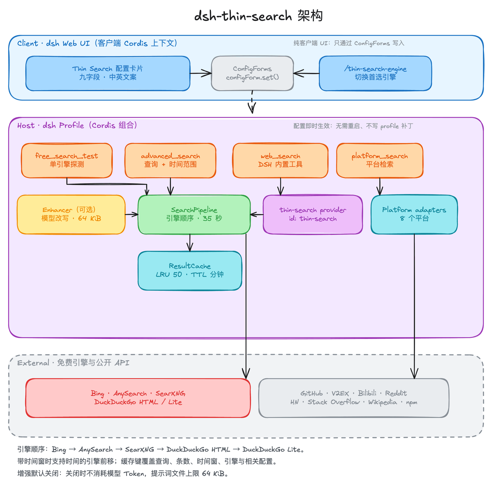

<h1 align="center">dsh-thin-search</h1>

<p align="center">
  <strong>简体中文</strong> · <a href="README.en.md">English</a>
</p>

<p align="center">
  <a href="https://github.com/topics/dsh-plugin"></a>
  <a href="https://opensource.org/licenses/MIT"></a>
  <a href="https://www.npmjs.com/package/@deepseek-ai/dsh"></a>
  <a href="https://nodejs.org">=24.9" src="https://img.shields.io/badge/node-%3E%3D24.9-339933?style=flat" /></a>
</p>

<p align="center">
  <strong>免费、免密钥的网页搜索：用对免费引擎的普通 HTTP 请求，替代模型驱动的搜索调用。</strong><br>
  原生 <code>WebSearchProvider</code>（<code>id: thin-search</code>），五引擎自动回退、时间范围与结果缓存，
  只有在显式开启查询增强时才消耗模型 Token。
</p>

v1.0.0 是面向 **DSH 0.2.2-rc.3** 的完全重写，**只支持该版本**：不为 DSH 0.1.x、0.2.0 与 0.2.1
保留兼容分支。

## ✨ 功能

- **五个免费引擎，自动回退**：Bing（默认）、AnySearch、SearXNG、DuckDuckGo HTML 与
  DuckDuckGo Lite。
- **原生搜索提供方**：注册 `WebSearchProvider`（`id: thin-search`），与其他已注册的提供方共存，
  通过全局网页搜索设置选择。
- **时间范围**：`advanced_search` 支持固定档位、相对时长与绝对日期。
- **结果缓存**：内存 LRU，TTL 以分钟计；缓存先于增强查询，命中缓存从不调用模型。
- **可选的查询增强**：经由当前 Agent 模型改写查询，支持独占的 `provider:model` 覆盖与提示词文件。
- **八个平台适配器**：GitHub、V2EX、Bilibili、Reddit、Hacker News、Stack Overflow、Wikipedia
  与 npm。
- **三个 Agent 工具**：均转发取消信号，并以文本内容块渲染结果。
- **原生配置卡片**：位于已安装插件详情页（插件 → 已安装 → dsh-thin-search → 配置），内置中英文案，
  并提供 `/thin-search-engine` 指令。
- **不碰部署文件**：没有 HTTP 桥、没有私有配置存储、不写 profile 补丁；提供方切换走 ConfigForms，
  即时生效。

## 📦 环境要求

| 项目 | 要求 |
|---|---|
| DSH | `0.2.2-rc.3`（精确版本，声明于 `engines.dsh` 与 peer 依赖） |
| Node | Node 24.9 或更新（`engines.node`：`>=24.9.0`） |
| Cordis | `~4.1.0` |
| 运行时依赖 | `@deepseek-ai/schemastery`、`node-html-parser` |

## 🚀 安装

```sh
dsh plugin --profile web add dsh-thin-search
```

重启一次 `dsh web`。bundle 补丁会插入 `thin-search` 行并写入首次启动的默认值：

```yaml
- insert:
    - id: thin-search
      name: dsh-thin-search
      config:
        provider: bing
        bingMarket: zh-CN
- id: web
  config:
    searchProvider: thin-search
    fetchProvider: http
```

补丁只设置 `web.searchProvider` 与 `web.fetchProvider`：它从不改写 profile，也不会编辑其他行。
卸载：

```sh
dsh plugin --profile web remove dsh-thin-search
```

卸载后重启，交给部署重新选择提供方。

## 🔄 从旧版本迁移

### 兼容性

| DSH 版本 | 状态 | 说明 |
|---|---|---|
| `0.2.2-rc.3` | ✅ 支持 | v1.0.0 的唯一目标版本，声明在 `engines.dsh` 与 peer 依赖中 |
| 更早的版本 | ❌ 不支持 | 0.2.2-rc.3 之前的版本不受支持：请继续使用 v0.6.x |

### 从 v0.6.x 及更早版本

v0.6.x 面向 DSH 0.1.7–0.2.1，附带插件级 HTTP 代理、设置桥与 UI 引擎测试控件；这些界面在 v1.0.0
中已移除。

1. 升级到 DSH 0.2.2-rc.3 与 Node 24.9+。无法升级的旧版 DSH 请继续使用 v0.6.x：兼容性由
   `engines.dsh` 与 peer 依赖声明，但插件不做运行时版本闸门。
2. 用 DSH 全局代理策略替换旧的 `proxy` 字段：启动 DSH 前设置 `HTTP_PROXY`、`HTTPS_PROXY`
   （必要时再加 `NO_PROXY`）。Thin Search 使用共享 HTTP 客户端，不再有插件级代理设置。
3. 删除旧的 `cache` 布尔字段：`cacheTtl` 现在同时充当开关（`0` 表示关闭），默认 `5` 分钟。
4. 用 `enhanceSystemPromptPath` 替换 `enhanceSystemPrompt`。提示词不再写在 `cordis.patch.yml`
   里；把它写入例如 `~/.dsh/thin-search/system-prompt.md` 的文件，并让该字段指向它。
5. 删除 profile 补丁里手工维护的 `web` 引擎模式块。bundle 补丁只在首次启动时固定提供方；
   之后的切换都走 ConfigForms 并立即生效。
6. 保留既有 Agent 指令：提供方 id `thin-search` 与工具名 `free_search_test`、`platform_search`、
   `advanced_search` 均未改变。
7. 从 profile 补丁的 `tools` 行删除 `tools.mode` 与 `tools.maxParallelSubCalls`。DSH
   0.2.2-rc.3 把这两个字段声明为 `z.never()`，任何取值都会被拒绝；组合应改为挂载执行器，
   例如原生或 PTC 工具执行器包（`@deepseek-ai/dsh-tool-executor-native` 或
   `@deepseek-ai/dsh-tool-executor-ptc`），不要设置这两个字段。

## ⚙️ 配置

每个可编辑字段都是易失的，并显示在已安装插件的配置卡片上。schema 是封闭的：恰好九个字段。

| 字段 | 默认值 | 说明 |
|---|---|---|
| `provider` | `bing` | 首选免费引擎；回退仍然生效。 |
| `platforms` | 全部八个 | `platform_search` 可以查询的平台。 |
| `cacheTtl` | `5` | 结果缓存寿命（分钟）；`0` 表示关闭。 |
| `searchEnhance` | `false` | 是否启用查询增强（每次缓存未命中多一次模型调用）。 |
| `enhanceModel` | 空 | `provider:model` 覆盖；留空使用当前 Agent 模型。 |
| `enhanceSystemPromptPath` | 空 | 提示词文件；留空使用内置提示词。 |
| `bingMarket` | `zh-CN` | Bing 的 `mkt` 市场值。 |
| `region` | 空 | DuckDuckGo 的 `kl` 地区值，例如 `cn-zh`。 |
| `searxngInstances` | 空 | 绝对的 http(s) SearXNG 基址（可含子路径，如 `https://host/searxng`）；留空使用内置实例。 |

在 **插件 → 已安装 → dsh-thin-search → 配置** 中编辑。该入口是已安装插件自己的配置卡片，
**没有全局设置项**。存储与持久化由 Host 通过 ConfigForms 负责：每个控件以 `ConfigForm.set`
立即写入自己的字段，只读或被拒绝的写入会就地提示。

## 🔀 提供方切换

已安装插件的配置卡片中有 **搜索提供方** 分组。它列出 Host 通过 `ctx.remote.web.listProviders()`
报告的提供方，并用 `configForms.get("web").set("searchProvider", id)` 切换全局选择。写入被 Host
接受后即时生效：无需重启，也无需编辑补丁。

`/thin-search-engine` 指令只修改首选免费引擎，写入
`configForms.get("thin-search").set("provider", id)`。全局提供方选择与引擎选择彼此独立。

## 🧠 搜索增强与提示词文件

增强默认关闭。开启后，每次缓存未命中都会向当前 Agent 模型（或配置的 `provider:model`）发送一个
短请求来改写查询。`enhanceModel` 是独占的：该模型失败时使用原始查询，不会再调用其他模型。

系统提示词来自 `enhanceSystemPromptPath`：

- 留空：使用内置提示词。
- `~/...` 或绝对路径：每次增强请求时读取文件，可随搜索一起取消，上限 64 KiB。
- 相对路径无效：使用内置提示词并记录一条警告。
- 文件不可读、内容空白或超出上限时回退到内置提示词，并记录警告。

提示词内容从不进入 `cordis.patch.yml`。请使用插件数据文件，例如
`~/.dsh/thin-search/system-prompt.md`。

## 🛠 工具

| 工具 | 超时 | 用途 |
|---|---|---|
| `free_search_test` | 65 秒 | 逐个探测引擎，报告每个引擎的状态。 |
| `platform_search` | 30 秒 | 查询一个启用的平台。 |
| `advanced_search` | 60 秒 | 支持 `timeRange` 与可选首选引擎的网页搜索。 |

三个工具都会把 `exec.signal` 传入 HTTP 客户端，因此取消会中止在途请求。工具抛出的每个失败都是
`WebError`，结果里保留错误码：参数非法是 `WEB_INVALID_REQUEST`，取消是 `WEB_ABORTED`，
上游失败是 `WEB_PROVIDER_ERROR` 并把原始错误挂在 `cause` 上。单引擎失败是数据而不是错误：
`free_search_test` 在结果中报告，而不是抛出。输出渲染为文本内容块而不是裸字符串，并在拼装
Markdown 前转义不可信的标题、摘要与 URL 文本。

## 🏗️ 架构

Thin Search 分两层：**Host** 侧注册搜索提供方、三个 Agent 工具与一段系统提示词；**Client** 侧只有配置卡片与
`/thin-search-engine` 指令，所有写入都经 ConfigForms。搜索请求按引擎顺序自动回退，缓存命中时不调用模型。

<p align="center">
  
</p>

## 🌐 引擎、时间范围与缓存

没有时间窗时首选引擎先跑。有时间窗时，支持时间过滤的引擎（SearXNG、DuckDuckGo、DuckDuckGo Lite）
前移，因为 Bing 与 AnySearch 无法应用原生过滤。任何失败、空结果或非法 URL 结果都会落到下一个引擎。
结果说明会写明实际作答的引擎；当该引擎无法应用时间窗时会明确说明——带时间过滤的搜索绝不会静默
返回未过滤的结果。

时间输入接受 `day` / `week` / `month` / `year`，`12h`、`3d`、`2mo`、`1y` 这类相对时长，
以及 `2026-07-01` 这类绝对日期。绝对日期按本地日历日读取，换算成距今天数，再为支持时间的引擎映射到
最近的固定档位。晚于本地今天的日期会作为非法输入被拒绝，而不是被截断到最后一天；未知的 `engine`
取值会报错，而不是被静默忽略。

网络错误、请求超时与 5xx 响应会重试一次。HTTP 202、403 与真正的反爬中间页会立即失败并落到下一个
引擎。JSON 响应永远不会被当作挑战页，即使负载文本里出现「captcha」或「access denied」这类词。

缓存是 50 条的内存 LRU。键包含查询、结果条数、时间窗、引擎，以及会改变结果的配置字段（市场、地区、
SearXNG 实例、增强设置）。因此配置变更不会返回过期答案。

## 📋 平台限制

| 平台 | 限制 |
|---|---|
| GitHub | 公开仓库搜索；受未认证限流影响。 |
| V2EX | 只搜索当前热帖列表；公开 API 没有全文搜索。 |
| Bilibili | 可能拒绝数据中心或代理出口 IP 的请求。 |
| Reddit | 可能拒绝数据中心或代理出口 IP 的请求。 |
| Hacker News | 公开搜索 API；无需认证。 |
| Stack Overflow | 公开 Stack Exchange API；有配额限制。 |
| Wikipedia | MediaWiki 搜索 API。 |
| npm | Registry 搜索；仅包元数据。 |

禁用某个平台会把它从工具中移除；对已禁用的平台调用 `platform_search` 会返回明确的配置错误。

## 🔌 全局代理

Thin Search 没有代理字段。它使用 DSH 的 HTTP 栈，因此全局代理策略适用于每个请求：在启动
`dsh web` 的环境里设置 `HTTP_PROXY` 和/或 `HTTPS_PROXY`（必要时再加 `NO_PROXY`）。
这影响整个 DSH，而不只是本插件。没有单独的代理组件、没有 SOCKS 代理选项，也没有按插件绕过的开关。

## 🔒 安全与数据处理

- 结果 URL 只在是绝对 `http:` 或 `https:` 时被接受；相对、`javascript:`、`data:`、
  `mailto:` 与 `ftp:` URL 会被丢弃。
- 来源按 URL 去重并在送给 Agent 前归一化。
- 没有 HTTP 桥、没有自定义传输层、没有私有设置存储。
- Client bundle 只依赖 `react` 与 `react/jsx-runtime`；它不发起网络请求，只通过 ConfigForms 写入。
- 插件不写 profile 文件，也不修改部署补丁。
- 增强是选择加入的；关闭时不消耗任何模型 Token。

## 🧑‍💻 开发与验证

```sh
npm ci
npm run check
npm pack --dry-run
```

`npm run check` 依次执行：

1. `typecheck:host` 与 `typecheck:client`。host 侧类型检查不依赖 DOM；浏览器侧类型检查拥有 DOM lib。
2. `test:host`、`test:client` 与 `test:integration`。
3. `build:host` 与 `build:client`（tsdown 输出 `lib/index.js` 与 `lib/client.js`），随后是
   `smoke:client`，它通过 `window.__ModuleLoader__.load` 加载构建后的浏览器 bundle。

CI 会在跑测试前先构建，并在新构建产物与已提交的 `lib` 树不一致时失败。

多数集成用例加载 `lib/index.js` 或 `lib/client.js`；缓存、时间范围与配置辅助函数直接导入源码模块。
测试使用桩网络覆盖提供方注册、九字段配置 schema、缓存与时间范围行为、工具取消、URL 校验、
构建后客户端表单映射与发布包文件清单。

`npm pack --dry-run` 必须列出 `lib/index.js`、`lib/client.js`、`locale/en.json`、
`locale/zh.json`、`icon.svg`、`cordis.patch.yml`、`CHANGELOG.md`、`README.md`、
`LICENSE` 与 `package.json`，且不含测试、源码或临时文件。

## ⚠️ 验证限制

- 测试套件不调用真实搜索引擎。它们回放录制的 HTML/JSON 样本与桩 HTTP 响应；引擎标记可能随时变化。
- 已安装插件的配置卡片通过单元/SSR/交互测试、构建后 bundle 的 ModuleLoader smoke 与集成测试验证。
  构建本版本时所用的 DSH profile 并未安装该插件，因此卡片没有在运行中的 DSH GUI 里实测。
- GitHub、npm、Stack Exchange 与 Reddit 的限流会变化；CI 只能证明代码路径，不能证明这些公开服务的可用性。
- CI 在 Linux 上运行 Node 24.9；其他平台不在发布闸门内。

## 📄 许可证

MIT，见 [LICENSE](LICENSE)。
